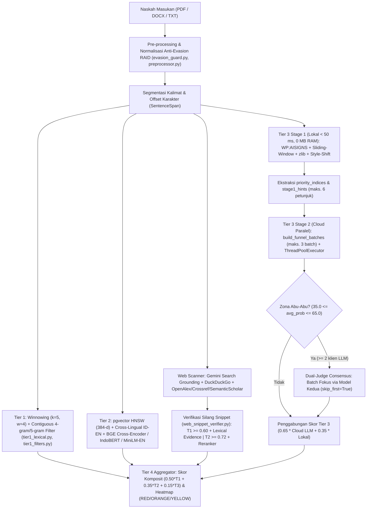

# Arsitektur Two-Stage Funnel & Pengetatan Mesin Deteksi Plagiarisme/AI: VeriText AI

Dokumen ini memaparkan rancangan teknis arsitektur **Two-Stage Funnel** untuk deteksi teks AI (Tier 3), aturan pengetatan anti-*false positive* pada deteksi plagiarisme (Tier 1, Tier 2, dan Web Scanner), perluasan korpus pembanding multi-sumber, pemetaan modul atomik Sub-150 LOC, serta panduan deployment VPS produksi pada repositori **VeriText AI**.

---

## 1. Ringkasan Eksekutif & Motivasi Arsitektur

Pendekatan deteksi teks AI konvensional menghadapi dua kendala mendasar pada lingkungan produksi berbiaya efisien (laptop pengembangan maupun VPS 4–8 GB RAM):

1. **Beban Memori & Komputasi Model Lokal Besar**: Menjalankan detektor berbasis LLM lokal (seperti RoBERTa-Large atau DeBERTa) pada seluruh paragraf membutuhkan alokasi RAM/VRAM gigabyte tambahan dan latensi tinggi di CPU.
2. **Titik Buta Sampling Stratifikasi Tunggal**: Mengirim sampel acak/stratifikasi tunggal secara langsung ke *cloud LLM* berisiko melewatkan blok kalimat AI yang disisipkan di tengah naskah atau manipulasi karakter (*adversarial evasion*) yang tidak terlihat secara visual.

Arsitektur **Two-Stage Funnel** menyelesaikan kedua persoalan tersebut tanpa mengorbankan akurasi:

* **Stage 1 (Lokal Ringan — 0 MB RAM tambahan, < 50 ms)**: Memindai **100% kalimat naskah** secara deterministik menggunakan modul normalisasi anti-evasion (RAID), indikator gaya penulisan `WP:AISIGNS`, *sliding-window local burstiness*, rasio kompresi `zlib`, dan deteksi pergeseran gaya (*intrinsic style-shift*).
* **Stage 2 (Cloud Paralel — 0 MB RAM lokal)**: Memanfaatkan hasil Stage 1 sebagai `priority_indices` dan `stage1_hints` untuk menyusun hingga 3 batch merata (awal, tengah, akhir naskah) yang dieksekusi paralel melalui `DualEngineLLMGateway`. Bila skor probabilitas berada pada zona abu-abu (`35.0 <= avg_prob <= 65.0`), sistem otomatis memicu **Gray-Zone Dual-Judge Consensus** menggunakan model evaluator kedua.

Seluruh komponen pengetatan plagiarisme (Tier 1, Tier 2, Web Scanner) dan modul Two-Stage Funnel dibangun mengikuti prinsip **Single Responsibility Principle (SRP)** dengan batas maksimal **150 baris kode per berkas (Sub-150 LOC)** dan kebijakan **Zero-Emoji**.

---

## 2. Diagram Alur Arsitektur

Diagram berikut menggambarkan alur pemrosesan end-to-end mulai dari masukan naskah hingga agregasi skor komposit dan anotasi heatmap.



---

## 3. Pengetatan Deteksi Plagiarisme (Tier 1, Tier 2, Web Scanner)

Pengetatan diterapkan pada tiga lapisan deteksi plagiarisme untuk menghilangkan positif palsu akibat kesamaan topik umum, frasa transisi akademik standar, atau kecocokan kata kunci yang tersebar acak (*scattered keywords*).

| Lapisan / Berkas | Mekanisme Pengetatan | Aturan & Ambang Teknis | Tujuan Anti-*False Positive* |
| :--- | :--- | :--- | :--- |
| **Tier 1 Filter** (`tier1_filters.py`) | Penyaringan heading & boilerplate akademik | `is_heading_or_too_short(..., min_content_words=5)` memeriksa `_HEADING_RE`, `_BOILERPLATE_RE` (mis. *"Bab ini membahas..."*, *"Tujuan penelitian ini adalah..."*, *"Pada bab ini/sebelumnya..."*), dan minimal 5 *content words* (`len(w) >= 4` di luar `STOPWORDS` ID+EN). | Mencegah judul bab dan kalimat pembuka klise skripsi terhitung sebagai plagiarisme. |
| **Tier 1 Filter** (`tier1_filters.py`, `tier1_lexical.py`) | Verifikasi *contiguous phrase* & rasio sidik jari | `has_lexical_evidence()` mewajibkan irisan minimal **4-gram token bebas stopword** atau **5-gram token mentah**; `tier1_lexical.py` juga mewajibkan rasio sidik jari cocok per dokumen `>= 0.45` dan minimal `>= 4` sidik jari cocok. | Menolak kalimat yang hanya berbagi kata umum tersebar tanpa penyalinan frasa berurutan. |
| **Tier 1 Snippet** (`tier1_filters.py`) | Pemilihan cuplikan sumber terbaik | `pick_best_matching_snippet()` memecah abstrak/teks kandidat korpus menjadi kalimat dan memilih segmen dengan irisan `content_words` terbanyak. | Memastikan cuplikan pembanding pada panel bukti benar-benar kalimat yang relevan. |
| **Web Verifier** (`web_snippet_verifier.py`) | Verifikasi silang bebas stopword & dua jalur | `lexical_sim` dihitung berbasis `content_words` dan sidik jari Winnowing. Jalur **T1**: `lexical_sim >= 0.60` dan `has_lexical_evidence() == True`. Jalur **T2**: `semantic_sim >= 0.72` dan lolos `SemanticReranker.accept_mask()`. | Menolak halusinasi kutipan LLM atau ringkasan web yang hanya bertopik mirip. |
| **Tier 2 Semantik** (`tier2_semantic.py`) | Guard *single-hit* dokumen panjang | Untuk naskah `> 5` kalimat (`len(sentences) > 5`), kemunculan tunggal (*single-hit*) dari satu `corpus_doc_id` dengan `similarity < 0.80` dibuang; hanya dipertahankan jika `doc_cnt[did] > 1` atau `similarity >= 0.80`. | Mencegah kecocokan kebetulan satu kalimat terisolasi terhadap jutaan segmen korpus. |
| **Tier 2 Reranker** (`tier2_reranker.py`, `language_detector.py`) | Routing bahasa & jalur *Cross-Lingual* `ID <-> EN` | Lapis 1 memakai Cross-Encoder `BAAI/bge-reranker-v2-m3` (`RERANKER_THRESHOLD = 0.5`). Pasangan `id-id` diteruskan ke `IndoBertScorer` (`INDOBERT_MIN_SIM = 0.45`); pasangan `en-en` ke `EnglishReranker` (`ms-marco-MiniLM-L-6-v2`, `0.45`); pasangan **lintas bahasa (`ID <-> EN`)** melewati reranker monolingual dan diverifikasi oleh gerbang **`cosine >= 0.80`**. | Menangkap plagiarisme terjemahan `ID <-> EN` tanpa bias penolakan dari model monolingual. |

---

## 4. Arsitektur Deteksi Pola AI — Two-Stage Funnel (Tier 3)

### 4.1. Stage 1: Sinyal Lokal Ringan (0 MB RAM Tambahan, < 50 ms)

Stage 1 beroperasi murni di CPU tanpa memuat model neural tambahan. Seluruh kalimat non-sitasi (`not s.is_citation and s.word_count > 0`) dievaluasi oleh `evasion_guard.py`, `tier3_patterns.py`, dan `tier3_stylometric.py`.

| Modul | Kunci Sinyal / Metode | Skor / Ambang | Kondisi Pemicu Teknis | Kontrol *False Positive* |
| :--- | :--- | :--- | :--- | :--- |
| `evasion_guard.py` | `evasion_zw` (Anti-Evasion RAID) | `0.92` | Terdeteksi karakter tak terlihat (`U+200B..U+200F`, `U+202A..U+202E`, `U+2060`, `U+FEFF`, `U+00AD`). | Karakter normalisasi dibersihkan terlebih dahulu di `TextPreprocessor` (`normalize_evasion`) sebelum Winnowing/tokenisasi. |
| `evasion_guard.py` | `evasion_homoglyph` (Anti-Evasion RAID) | `0.92` | Terdeteksi huruf Cyrillic homoglyph (18 huruf seperti `\u0430`, `\u0435`, `\u043e`, `\u0440`, `\u0441`, dll.) bercampur huruf Latin (`_LATIN_RE`). | Hanya aktif jika aksara Cyrillic muncul bersama teks Latin, tidak mengganggu teks non-Latin murni. |
| `tier3_patterns.py` | `chatbot_artifact` (`WP:AISIGNS`) | `0.95` | Format Markdown (`**...**`, heading `## `) atau frasa asisten (*"tentu, berikut adalah"*, *"semoga membantu"*, *"sebagai model bahasa"*, *"as an ai language model"*, *"certainly! here is"*, *"i hope this helps"*). | Fokus pada frasa meta-percakapan chatbot dan markup Markdown yang tidak lazim pada naskah akademik final. |
| `tier3_patterns.py` | `em_dash` (`WP:AISIGNS`) | `0.80` | Kemunculan tanda pisah em-dash (`\u2014`) atau spasi double-hyphen (`\w -- [A-Za-z]`). | En-dash rentang angka (`2020–2024`) dan tanda hubung kata majemuk (`berbasis-web`) dikecualikan. |
| `tier3_patterns.py` & `tier3_stylometric.py` | `label_colon` (`WP:AISIGNS`) | `0.78` (eskalasi `0.90`) | Label singkat 1–5 kata diikuti titik dua (`:`) dan badan penjelasan `>= 8` kata. Naik menjadi `0.90` jika beruntun dalam jarak `<= 2` kalimat (`_escalate_consecutive_labels`). | `EXCLUDED_LABEL_PREFIXES` mengecualikan `gambar`, `tabel`, `bab`, `lampiran`, `sumber`, `catatan`, `contoh`, `rumus`, `persamaan`, `figure`, `table`, `source`, `note`, `chapter`, `appendix`, `http`, `https`, serta tautan `://`. |
| `tier3_patterns.py` | `ai_vocab_density` (`WP:AISIGNS`) | `0.76` | Terdapat `>= 3` kosakata unik dari `AI_BUZZWORDS` (20 kata klise ID/EN, mis. `delve`, `tapestry`, `pivotal`, `katalisator`, `transformatif`, `komprehensif`, `holistik`, `sinergi`) dalam satu kalimat. | Penggunaan wajar 1–2 istilah akademik per kalimat tidak memicu penalti. |
| `tier3_patterns.py` | `puffery` (`WP:AISIGNS`) | `0.74` | Ungkapan hiperbolis signifikansi (*"meninggalkan warisan mendalam/abadi"*, *"membentuk ulang masa depan"*, *"tonggak bersejarah"*, *"stands as a testament"*, dll.). | Pola frasa spesifik multi-kata sehingga klaim ilmiah terukur tidak tertangkap. |
| `tier3_patterns.py` | `transition` | `0.72` | 16 pola transisi generatif dalam `AI_TRANSITION_MARKERS` (mis. *"dalam era digital ini"*, *"penting untuk dicatat"*, *"memainkan peran krusial"*). | Hanya mendeteksi frasa transisi formulaik penuh. |
| `tier3_patterns.py` | `vague_attribution` (`WP:AISIGNS`) | `0.72` | Atribusi tanpa sumber (*"para ahli berpendapat"*, *"beberapa pengamat mencatat"*, *"banyak pihak meyakini"*, *"experts argue"*, *"some critics claim"*). | **Otomatis dibatalkan** jika kalimat memiliki sitasi inline (`INLINE_CITATION_RE`), mis. `(Santoso, 2024)` atau `[1]`. |
| `tier3_patterns.py` | `triad` | `0.68` | Enumerasi tiga frasa sejajar (`RULE_OF_THREE_PATTERN`), mis. `"cepat, aman, dan efisien"`. | Mensyaratkan minimal 4 huruf per kata pada pola tiga serangkai. |
| `tier3_stylometric.py` | *Sliding-Window Local Burstiness* | `>= 0.70` | Jendela luncur 5 kalimat berturut-turut dengan `l_burst < 0.12`, `l_sigma <= 2.5`, dan `l_mu >= 10.0`. | Menangkap paragraf AI yang disisipkan di tengah naskah manusia tanpa memicu positif palsu pada kalimat pendek bervariasi. |
| `evasion_guard.py` | *Intrinsic Style-Shift* + `zlib` | `>= 0.72` | Blok 10 kalimat (`block_size=10`, minimal 2 blok) dengan `shift_hit` (`abs(mean_wc - med_wc) / med_wc >= 0.45` dan `comp_ratio <= 0.58`) atau `entropy_hit` (`total_words >= 60` dan `comp_ratio <= 0.46`). | Memerlukan kombinasi deviasi panjang ekstrem terhadap median dokumen dan rasio kompresi `zlib` rendah (redundansi sintaksis tinggi). |

### 4.2. Stage 2: Evaluasi Cloud Paralel & Gray-Zone Dual-Judge (`funnel_judge.py` & `gateway.py`)

Stage 2 dipicu oleh `GeminiAIDetector.analyze_document` apabila panjang naskah melebihi `WEB_SCAN_MAX_SENTENCES` atau Stage 1 menghasilkan `stage1_hints`:

1. **Penyusunan Batch Merata Terprioritas (`build_funnel_batches`)**:
   * Naskah dibagi menjadi hingga `max_batches = 3` segmen (awal, tengah, akhir) dengan ukuran hingga `batch_size = min(25, WEB_SCAN_MAX_SENTENCES)` per batch.
   * Pada setiap segmen, `_select_segment_sentences` memprioritaskan kalimat yang ditandai Stage 1 (`priority_indices`) beserta kalimat tetangganya (`p - 1`, `p + 1`) agar konteks transisi tetap utuh, lalu melengkapi sisa slot dengan sampel merata.
2. **Eksekusi Paralel & *Signal-Guided Prompt***:
   * `evaluate_funnel_parallel` mengirimkan seluruh batch secara konkuren via `ThreadPoolExecutor(max_workers=len(batches))`.
   * Fungsi `DualEngineLLMGateway.build_judge_prompt` menyisipkan blok `stage1_hints` (maksimal 6 ringkasan sinyal lokal dari `_build_stage1_hints`) ke dalam prompt agar evaluator LLM memverifikasi konteks kalimat mencurigakan.
3. **Konsensus Zona Abu-Abu (*Gray-Zone Dual-Judge Consensus*)**:
   * Skor probabilitas rata-rata tertimbang jumlah kalimat per batch dihitung sebagai `avg_prob`.
   * Apabila `35.0 <= avg_prob <= 65.0` dan tersedia minimal 2 klien pada `gateway._client_order()`, sistem memilih satu batch paling kritis (`focus_idx` dengan skor temuan dan prioritas terbanyak), lalu memanggil `gateway.evaluate_batch(batches[focus_idx], stage1_hints=stage1_hints, skip_first=True)` menggunakan model kedua.
   * Probabilitas akhir dihitung sebagai rata-rata seimbang:
     $$\text{ai\_probability}_{\text{final}} = 0.5 \times \text{avg\_prob} + 0.5 \times \text{sec\_prob}$$
   * Anomali kalimat digabungkan (`confirm=True`), label evaluator dicatat sebagai `"{primary_name} + {sec_name}"`, dan skor akhir Tier 3 dihitung oleh `ai_detector.py` dengan formula:
     $$S_{\text{Tier3}} = 0.65 \times \text{ai\_probability}_{\text{final}} + 0.35 \times S_{\text{Stage1}}$$

---

## 5. Ekspansi Korpus Pembanding Multi-Sumber

Untuk memperkuat cakupan deteksi Tier 1 dan Tier 2, sistem menyediakan utilitas pemanen korpus otomatis melalui `backend/scripts/harvest_sources.py` dan `backend/scripts/harvest_corpus.py`.

### 5.1. Sumber Data & Mekanisme Akuisisi
* **OpenAlex (`fetch_openalex_sliced`)**: Menarik artikel dwibahasa (`language:id` dan `language:en`) lintas tahun publikasi dengan merekonstruksi `abstract_inverted_index` (hingga batas 4.000 posisi token).
* **DOAJ (`fetch_doaj_batch`)**: Menarik artikel jurnal *open access* berdasarkan 10 kueri topik akademik (`indonesia`, `pendidikan`, `kesehatan`, `ekonomi`, `hukum`, `teknologi`, `machine learning`, `education`, `public health`, `computer science`).
* **arXiv (`fetch_arxiv_batch`)**: Menarik pracetak Atom XML dari 8 kategori (`cs.AI`, `cs.CL`, `cs.LG`, `cs.CV`, `cs.SE`, `stat.ML`, `math.OC`, `physics.soc-ph`).

### 5.2. Perintah CLI & Deduplikasi
```bash
cd backend
./venv/bin/python scripts/harvest_corpus.py --source all --target 15000 --years 2025,2024,2023,2022,2021,2020
```
* `--source`: Pilihan sumber (`all`, `openalex`, `doaj`, `arxiv`; default `all`).
* `--target`: Target jumlah dokumen baru yang disimpan pada satu sesi (default `15000`).
* `--years`: Daftar tahun publikasi OpenAlex dipisah koma (default `2025,2024,2023,2022,2021,2020`).
* **Deduplikasi & Kualitas**: Setiap kandidat wajib memiliki judul `>= 8` karakter, abstrak `>= 35` kata, serta minimal 1 kalimat valid (`>= 5` kata). Hash `SHA-256` dari `f"{title}\n{abstract}"` dicocokkan terhadap kolom `sha256_hash` pada tabel `corpus_documents` agar tidak ada duplikasi lintas sesi. Setiap 150 dokumen baru langsung di-embed (384-d ke `document_chunks`) dan diindeks sidik jari Winnowing (`lexical_fingerprints`).

### 5.3. Statistik Korpus Terkini
* **Total Dokumen Terindeks (`corpus_documents`)**: ~**25.961 dokumen**
* **Total Segmen Vektor HNSW (`document_chunks`)**: **207k+ segmen vektor 384-d**
* **Total Sidik Jari Winnowing (`lexical_fingerprints`)**: **11,3 juta fingerprint**

---

## 6. Pemetaan Berkas Atomik (Kepatuhan Sub-150 LOC)

Seluruh modul baru maupun hasil refactoring mematuhi batasan maksimal 150 baris kode per berkas (`wc -l`) dengan satu tanggung jawab tunggal:

| Berkas | LOC (`wc -l`) | Tanggung Jawab Tunggal (SRP) |
| :--- | :---: | :--- |
| `backend/app/engine/tier1_filters.py` | 67 | Filter heading/boilerplate akademik, `STOPWORDS`, bukti frasa berurutan 4-gram/5-gram, dan pemilihan cuplikan terbaik. |
| `backend/app/engine/tier1_lexical.py` | 132 | Ekstraksi sidik jari Winnowing dan penyaringan kecocokan kalimat berbasis rasio sidik jari dan bukti leksikal. |
| `backend/app/engine/web_snippet_verifier.py` | 125 | Ekstraksi respons grounding web dan verifikasi silang T1/T2 bebas stopword. |
| `backend/app/engine/tier2_semantic.py` | 148 | Pencarian semantik 384-d (HNSW + memori), integrasi reranker, dan guard *single-hit* `< 0.80`. |
| `backend/app/engine/tier2_reranker.py` | 80 | Orkestrasi Cross-Encoder BGE-M3 serta routing bahasa ID, EN, dan jalur *Cross-Lingual* `cosine >= 0.80`. |
| `backend/app/engine/tier2_indobert.py` | 53 | Skor kemiripan kosinus bi-encoder IndoBERT 768-d untuk pasangan bahasa Indonesia. |
| `backend/app/engine/tier2_en_reranker.py` | 46 | Cross-Encoder ringan `ms-marco-MiniLM-L-6-v2` untuk pasangan bahasa Inggris. |
| `backend/app/engine/language_detector.py` | 45 | Deteksi bahasa `id` vs `en` berbasis `lingua-language-detector`. |
| `backend/app/engine/evasion_guard.py` | 85 | Normalisasi anti-evasion RAID (zero-width & homoglyph Cyrillic), rasio kompresi `zlib`, dan deteksi *style-shift* blok. |
| `backend/app/engine/tier3_patterns.py` | 123 | Detektor pola `WP:AISIGNS` (`chatbot_artifact`, `em_dash`, `label_colon`, `ai_vocab_density`, `puffery`, `transition`, `vague_attribution`, `triad`). |
| `backend/app/engine/tier3_stylometric.py` | 145 | Mesin stilometri Stage 1: Burstiness, TTR, *sliding-window* 5 kalimat, eskalasi label beruntun, dan penyusunan `stage1_hints`. |
| `backend/app/engine/ai_detector.py` | 134 | Orkestrator Two-Stage Funnel Tier 3 dan penggabungan skor Stage 1 + Stage 2. |
| `backend/app/llm/funnel_judge.py` | 135 | Pembuatan batch funnel merata, eksekusi `ThreadPoolExecutor` paralel, dan *Gray-Zone Dual-Judge Consensus*. |
| `backend/app/llm/gateway.py` | 143 | Dual-Engine LLM Gateway, *Signal-Guided Prompt* (`stage1_hints`), dan failover otomatis Gemini/DeepSeek/Nemotron/Ollama. |
| `backend/scripts/harvest_sources.py` | 120 | Klien pengambilan data API OpenAlex (multi-tahun ID/EN), DOAJ, dan arXiv. |
| `backend/scripts/harvest_corpus.py` | 144 | Pipeline CLI pemanen korpus dengan deduplikasi SHA-256 dan batch indexing ke PostgreSQL/pgvector. |

---

## 7. Panduan Deployment & Spesifikasi Minimal VPS

Karena Stage 1 berjalan ringan tanpa model neural tambahan dan Stage 2 memanfaatkan *cloud LLM* secara paralel, sistem dapat dijalankan pada VPS kelas ekonomis dengan konfigurasi terukur:

| Profil VPS | vCPU | RAM & Swap | Penyimpanan | Kapasitas & Catatan Operasional |
| :--- | :---: | :--- | :--- | :--- |
| **Minimal (Starter Production)** | 2 vCPU | 4 GB RAM + 4 GB Swap | 40 GB NVMe SSD | Memadai untuk 1 proses worker Celery (`--concurrency=1`) dengan pgvector HNSW + Redis + FastAPI. |
| **Rekomendasi (Multi-User Optimal)** | 4 vCPU | 8 GB RAM | 60–80 GB NVMe SSD | Mendukung `--concurrency=2`, indeks HNSW tetap nyaman di *page cache*, dan ruang lega untuk pertumbuhan korpus. |

### Konfigurasi Wajib Produksi
1. **Concurrency Celery Terkendali**: Jalankan worker dengan `--concurrency=1` (VPS 4 GB) atau `--concurrency=2` (VPS 8 GB) agar model `SentenceTransformer` dan `CrossEncoder` tidak terduplikasi melebihi kapasitas RAM:
   ```bash
   ./venv/bin/celery -A app.workers.celery_app worker --loglevel=info --concurrency=1
   ```
   Konfigurasi di `backend/app/workers/celery_app.py` sudah mengaktifkan `worker_prefetch_multiplier=1`, `task_acks_late=True`, dan `task_time_limit=1800` untuk menjaga stabilitas antrean.
2. **PyTorch CPU-Only**: Pada server VPS tanpa GPU, instal `torch` versi CPU-only sebelum memasang `sentence-transformers` agar footprint disk dan memori tetap ramping tanpa pustaka CUDA.
3. **Nginx Static Build & Reverse Proxy**: Bangun bundel produksi frontend (`cd frontend && npm run build`) dan sajikan direktori `frontend/dist` langsung melalui Nginx sebagai berkas statis, sambil mem-proxy `/api/` ke proses Uvicorn (`127.0.0.1:8000`). Jangan menjalankan `vite dev` di server produksi.

---

## 8. Panduan Pengujian & Verifikasi

Seluruh perilaku Two-Stage Funnel, pengetatan plagiarisme, routing bahasa reranker, dan failover LLM diuji pada suite tes berikut di direktori `backend/tests/`:

| Berkas Tes | Cakupan Pengujian |
| :--- | :--- |
| `tests/test_two_stage_funnel.py` | Normalisasi & flag `evasion_zw` / `evasion_homoglyph`, sinyal `WP:AISIGNS`, deteksi *style-shift* blok 10 kalimat, jalur *Cross-Lingual* `ID <-> EN`, serta `build_funnel_batches` & *Gray-Zone Dual-Judge Consensus*. |
| `tests/test_hardening_plagiarism_and_ai.py` | Bukti leksikal 4-gram/5-gram, penolakan boilerplate, `pick_best_matching_snippet`, verifikasi silang web T1/T2, eskalasi `label_colon`, `triad`, *sliding-window* 5 kalimat, dan stratified sampling LLM. |
| `tests/test_tier3_ai_patterns.py` | Deteksi `em_dash` vs en-dash, pengecualian `label_colon` pada gambar/tabel/URL, penggabungan alasan anomali, dan kriteria prompt `build_judge_prompt`. |
| `tests/test_engine.py` | Integrasi penuh `TextPreprocessor`, `WinnowingLexicalEngine`, `SemanticEngine`, `StylometricEngine`, `HybridAggregator`, dan `execute_audit_pipeline`. |
| `tests/test_jalur1_gemini.py` | Parsing JSON Gemini/OpenRouter, retry HTTP 429/503, cache & deduplikasi `GeminiWebScanner`, fallback DuckDuckGo, dan refund token otomatis saat web scan gagal. |
| `tests/test_tier2_reranker.py` | Ambang `SemanticReranker`, pemisahan antonim vs parafrase, dan routing deteksi bahasa `id` vs `en`. |
| `tests/test_llm_gateway.py` | Pembersihan JSON LLM, `GeminiFlashClient`, `DeepSeekRouterClient`, serta mekanisme failover `DualEngineLLMGateway`. |

### Perintah Eksekusi Verifikasi
```bash
cd backend
./venv/bin/pytest tests/test_two_stage_funnel.py tests/test_hardening_plagiarism_and_ai.py tests/test_tier3_ai_patterns.py tests/test_engine.py tests/test_jalur1_gemini.py tests/test_tier2_reranker.py tests/test_llm_gateway.py -q
./venv/bin/ruff check app tests
```
